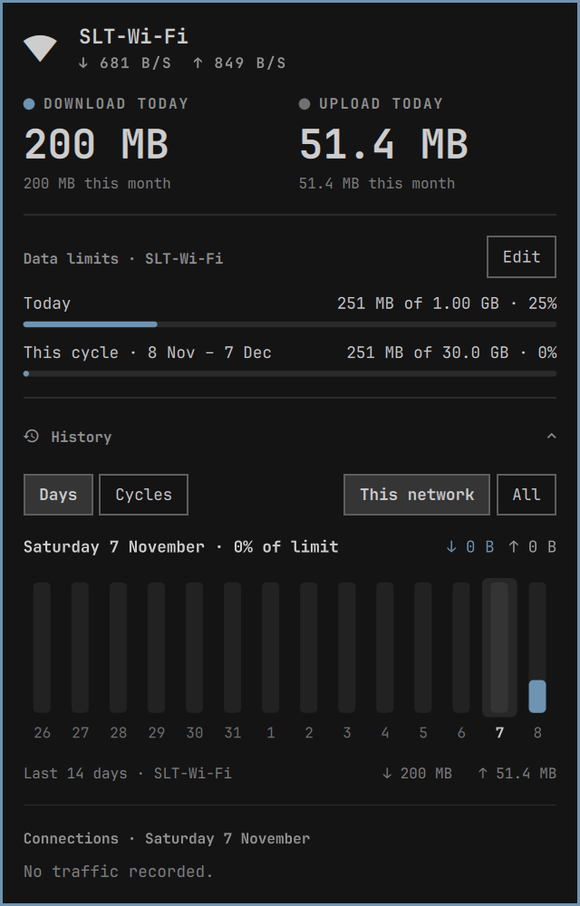

# NetCaptain



An Omarchy shell bar widget that tracks how much data you download and upload,
per day, per month and per network, with data limits and billing cycles.

Click the bar icon for the active connection, its live rate, today's totals and
your limits. Expand **History** (or press `h`) for a chart of the last 14 days
or 12 months and the networks used on the selected day. Click a network to see
its own history. Middle-click the icon to sample immediately.

## Install

```bash
omarchy plugin add https://github.com/Chamal1120/omarchy-netcaptain.git --enable
```

Update with `omarchy plugin update io.github.chamal1120.netcaptain`. It needs
Python 3 and NetworkManager, both standard on Omarchy.

Upgrading from a version before 0.5.0, which used the ID `omarchy-netcaptain`?
Run `omarchy plugin remove omarchy-netcaptain`, then add it again. Your history
and limits are kept.

## Remove

```bash
omarchy plugin remove io.github.chamal1120.netcaptain
```

Your history and limits stay in `~/.local/share/omarchy-netcaptain/` in case you
reinstall. Delete that folder to remove them too.

## Data limits

Each network can have a daily and a monthly limit, counting download and upload
together the way carriers do. Click *Set limits* (or press `l`) and type amounts
like `2 GB` or `500 MB`; a bare number means GB, and an empty field means no
limit. You get a notification at 90% and another at 100%, even with the popup
closed.

Set **Billing day** to the day your plan resets, and the monthly limit follows
that cycle (*This cycle · 15 Nov – 14 Dec*). The chart's Months view then
becomes **Cycles**.

**Keys:** `←`/`→` move along the chart, `d` days, `m` months, `a` cycle
networks, `l` edit limits, `↑`/`↓` and `Enter` pick a network, `r` refresh,
`h` toggle history, `Esc` close.

## Settings

| Key | Default | Meaning |
|---|---|---|
| `refreshIntervalSec` | `60` | Seconds between samples (10–3600) |
| `notifyLimits` | `true` | Notify at 90% and when a limit is reached |

## How it works

`netcaptain.py` reads the kernel byte counters in `/sys/class/net/*/statistics`
for hardware interfaces and adds each change to the connection NetworkManager
reports there. Bridges, Docker, veths and VPN tunnels are skipped, since their
traffic is already counted on the physical link. Everything is stored in SQLite
at `~/.local/share/omarchy-netcaptain/usage.db`.

Sampling runs only while the shell is running. Reboots and counter resets are
handled, but traffic from a boot that ended before the next sample is lost. It
makes no network requests and uses only Python's standard library and `nmcli`.

## Development

Link your clone into the plugins folder and run the watcher, which restarts the
shell on every save (the shell's own watcher doesn't follow symlinks):

```bash
ln -s ~/Projects/omarchy-netcaptain ~/.config/omarchy/plugins/io.github.chamal1120.netcaptain
omarchy plugin enable io.github.chamal1120.netcaptain
scripts/dev-watch
```

Remove any copy installed with `omarchy plugin add` first, since it uses the
same folder. Don't add symlinks inside the repository; validation rejects them.

`Panel.qml` is the entry point and holds all state; each popup section in `ui/`
reads `panel.<property>` and calls `panel.<action>()`. Pure helpers live in
`Model.js`, and `netcaptain.py` is the collector.

Run the checks before committing:

```bash
python3 -I -m unittest discover -s tests
node --test tests
scripts/qmllint
omarchy plugin validate .
```
